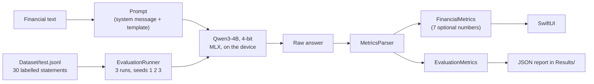

# FinancialEdgeAI

**Can a small language model extract structured financial data from text, running entirely on an iPhone?**
An iOS app, a labelled dataset and an evaluation harness that measure it.

## The question, and where this stands

> Can a small language model, specialised for a constrained financial information-extraction task, produce
> sufficiently reliable structured output to be useful for local inference on an iOS device?

The input is a sentence like *"Net income was $21 billion, down 4% from $21.9 billion in the previous year."*
The output is seven numbers, as JSON, decoded in Swift into a `FinancialMetrics` value.

**This repository answers the first half and prepares the second.**

- Done: the app, a 300-statement labelled dataset, a measuring harness that runs on the device, and a
  **baseline of the unmodified model**.
- Next (not implemented): **LoRA fine-tuning**, then the same evaluation on the same frozen test split.
  See [Next steps](#next-steps-lora-fine-tuning).
- **The hypothesis (specialisation helps) is untested.** Nothing here shows that fine-tuning improves the
  result. It shows what there is to improve.

## Results: the unmodified model

Model `Qwen3-4B` 4-bit (MLX), 30 frozen test statements, three runs, temperature 0.2, thinking off.
Full analysis: [`Results/baseline-analysis.md`](Results/baseline-analysis.md).

| Measure | Result |
|---|---|
| Answers the app can decode | **90 / 90 (100%)** |
| Exactly the 7 keys, each a number or null | 90 / 90 (100%) |
| Needed a Markdown fence or a reasoning block | 0 / 90 |
| **All 7 fields correct** | **57 / 90 (63.3%)** |
| Fields correct | 570 / 630 (90.5%) |
| All 7 correct, if a unit error (x1000) is accepted | 66 / 90 (73.3%) |

**Reading the format is solved. Choosing the right number is not.** All 60 wrong fields fall in 11 of the
30 statements, in four groups:

| Cause | Wrong fields | Example |
|---|---|---|
| Wrong unit | 33 | `2,772 million` returned as 2772 instead of 2.772 billion; `$6.9bn` returned as 6900 |
| Previous-year net income taken from another line | 15 | the previous-year *operating profit* returned as previous-year net income |
| Calculated instead of null (the prompt forbids it) | 9 | "10 against 9.7" returned as a growth of 0.3 (it is +3.1%) |
| A distractor read as a metric | 3 | the net income returned as revenue |

Growth values are 100% correct, including the sign, and statements with none of the requested metrics all
returned seven nulls.

### What the iPhone costs

A feasibility test on the iPhone (iOS 27.0.1, Debug build, 7 statements, [`Results/model-gate.md`](Results/model-gate.md)):

| | |
|---|---|
| Download + load, first launch | 463 s (7.7 min) for about 2.3 GB; offline afterwards |
| Time per statement | about 5.4 s (median), 4.9 to 5.5 s |
| Generation speed | 21.6 to 21.9 tokens/s |
| Peak MLX memory | 2.6 GB (the app was not killed) |
| Thermal state | nominal |

### Read these caveats before quoting a number

- **The baseline ran on a Mac, not on the iPhone.** The iPhone dropped its connection the night before the
  deadline, so the 90 answers were produced by the same app, model, prompt and seeds running as an iOS app
  on an Apple silicon Mac. Accuracy does not depend on the device. The speed and memory of that run are
  **not** iPhone numbers, so the table above takes them from the iPhone test. A run on the iPhone itself is
  still to be added.
- **The three runs are identical** (30 / 30 statements gave the same values every time), so the sample is 30
  statements, not 90 answers. One statement is 3.3 points.
- **Part of the unit result is the experiment's fault.** Rule 8 of the prompt does not ask the model to
  convert millions into billions, but the dataset labels do. The two statements where billions were turned
  into millions are real errors; the two where millions were left as millions arguably are not. The prompt
  has to be fixed, and the baseline repeated, before fine-tuning. A changed prompt is a new experiment.
- Debug build, one model, one prompt, synthetic short statements.
- "Valid JSON" means "the app's decoder can read it"; Foundation's parsers also accept a trailing comma.
- A first test with `gemma3_1B_qat_4bit` and an earlier prompt returned a fenced JSON and missed one value.
  That experiment is not comparable with this one.

## How it works



- **Model choice.** `qwen3_4b_4bit` was tested on the iPhone before use, against fixed criteria (not killed,
  at most 15 s per statement, at least 8 tokens/s, thermal state below "serious", download within 20
  minutes). It passed all of them, so the fallback `gemma3_1B_qat_4bit` was not needed.
- **Parser.** Tolerant about what surrounds the JSON (a reasoning block, a Markdown fence, a sentence),
  strict about the seven keys and their types. Swift's `Decodable` turns a missing optional key into `nil`,
  so the keys are checked explicitly. It records which tolerance it needed.
- **Evaluation.** Every value is *correct* (within 0.001), *hallucinated* (null expected, a number given),
  *missed*, a *sign error*, a *unit error* (x1000), or *wrong*. An unreadable answer is *unparsed*. Every
  statement gets a fresh chat session (a session remembers the conversation), a fixed seed and a token limit.
  The phone is not allowed to run hot: the runner waits while the thermal state is "serious".
- **The oracle test.** The dataset's own correct answers, fed through the parser and the metrics, must score
  100% on all 30 test statements. If they do not, the evaluation itself is wrong.

### The dataset

300 labelled statements ([`Dataset/`](Dataset/README.md)): 240 train, 30 validation, 30 test. 280 are generated
from templates (labels correct by construction), 20 are hand-written. The test split is frozen. Thirteen of
its 30 statements use wording that is not in train or validation, so it also tests unseen phrasing. The
scenarios include prior-year amounts that must be ignored, distractor numbers (margins, guidance),
statements in millions, and statements without any requested metric. The prompt lives once, in `Dataset/`, is
bundled in the app, and `Scripts/validate_dataset.py` fails if the two copies differ.

## Repository

```
FinancialEdgeAI/                 Xcode app target (Swift, SwiftUI, MLX)
├── App/        FinancialEdgeAIApp.swift       entry point, two tabs
├── Models/     FinancialMetrics, GenerationResult, ExtractionExample, EvaluationRecord
├── Services/   LLMService                     MLX model loading and inference
│               ExtractionPrompt, PromptTemplate
│               MetricsParser                  raw answer to FinancialMetrics
│               DatasetLoader, EvaluationMetrics, EvaluationRunner
├── ViewModel/  ChatViewModel, EvaluationViewModel
├── Views/      ContentView (Extract), EvaluationView (Evaluate, work in progress)
└── Resources/  prompt files and test split (bundled copies, checked for drift)
FinancialEdgeAITests/            Swift Testing, 37 tests
Dataset/                         300 labelled statements, the prompt, its README
Scripts/                         generate and validate the dataset, summarise a report
Results/                         model gate, baseline report, tables and analysis
```

## Run it

Requirements: Xcode 27, a **physical iPhone** (MLX cannot run on the simulator: the app starts there and
says so, instead of crashing), and a network connection on the first launch only.

1. Open `FinancialEdgeAI.xcodeproj`, select the iPhone, run.
2. The first launch downloads the model (about 2.3 GB). After that the app works offline.
3. **Extract** tab: paste a statement, or tap *Sample*, then *Send*. It shows the decoded values, what had to
   be skipped to read the answer, and what the answer cost (tokens/s, time, memory).
4. **Evaluate** tab (marked *work in progress*: a development tool that measures the model, not part of the
   final app): *Start evaluation* runs the 30 test statements three times (about 10 minutes). The
   screen stays on, because iOS does not allow GPU work in the background and MLX stops the app if it is
   attempted. *Share* exports the full JSON report.
5. `python3 Scripts/summarize_results.py <report.json>` prints the tables and every failing statement.

```
python3 Scripts/validate_dataset.py     # dataset format, labels, leakage, bundled copies
```

Unit tests: run the `FinancialEdgeAITests` scheme on a simulator. The test bundle compiles the pure sources
(parser, metrics, loader) directly and does not host the app, because a hosted test target would also have
to resolve every MLX package module and does not build.

### Reproducing a result

A report records the model, the device, the temperature, the token limit, the seeds, and SHA-256 hashes of
the prompt and of the test split. The baseline: Qwen3-4B 4-bit (`mlx-community/Qwen3-4B-4bit`),
`mlx-swift-lm` 3.32.3, `mlx-swift` 0.32.3, Xcode 27.1, temperature 0.2, `maxTokens` 256, seeds 1, 2, 3.

## Next steps: LoRA fine-tuning

The research question is about a **specialised** model. This work measures the unmodified model and builds
everything needed to measure a specialised one.

**What LoRA is.** Instead of changing all the weights, LoRA freezes them and learns a small correction next
to some of the weight matrices: two thin matrices `A` and `B` whose product has the shape of the original
matrix, so `output = W x + scale * B (A x)`. The size of `A` and `B` is the *rank*. For a 2048 x 2048 matrix,
rank 8 is 32,768 trained numbers instead of 4,194,304 (0.8%). The result is a small adapter file that can
stay separate from the model or be fused into it.

**Plan.**

1. **Fix the prompt first.** Say explicitly what rule 8 means for amounts in millions, then repeat the
   baseline. The labels must agree with the prompt, otherwise the unit errors measure the prompt and not the
   model.
2. Train on `Dataset/train.jsonl`, watching the loss on `Dataset/valid.jsonl`. Starting point: the defaults
   of the `mlx-swift-lm` trainer (rank 8, scale 10, 16 layers), a few hundred iterations, the same prompt and
   system message as the app.
3. Load the adapted model in the app and run the **same** evaluation on the **same** frozen test split with
   the same seeds, and compare with the baseline, cause by cause.
4. Report the cost too: adapter size, memory, speed on the iPhone.

The targets are concrete: the units, the previous-year number taken from the wrong line, and calculated
growth. Success criteria are set before training: fewer of these errors, no loss on the fields that are
already right, and a usable speed. A mixed or negative result is a valid result.

**Practical points.** `mlx-swift-lm` has a Swift LoRA trainer (`LoRATrain`), but its data loader reads
`{"text": ...}` lines, while the dataset uses the chat `messages` format that the Python tool `mlx_lm.lora`
reads directly: either that tool is used, or the dataset is converted. An adapter only works with the base
model it was trained on. Weights and adapters must not be committed (`.gitignore` excludes them).

**Other next steps.** A run on the iPhone itself, a Release build for the speed numbers, real reports
instead of synthetic statements, a larger test split, a comparison with a smaller model
(`gemma3_1B_qat_4bit`), and energy measurements.

## Documentation

The work is documented step by step in two Notion pages: *Guiding step* (what was done, why, what was
observed, in order) and *FinancialEdge Workflow* (the project brief, the roadmap and the decisions).

## Acknowledgements

[MLX](https://github.com/ml-explore/mlx) and [`mlx-swift-lm`](https://github.com/ml-explore/mlx-swift-lm)
for on-device inference, the `mlx-community` conversion of Qwen3-4B, and the Hugging Face Hub client for the
download.
