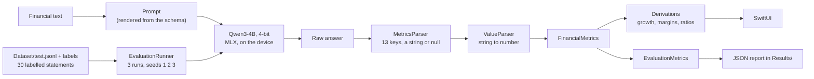

# FinancialEdgeAI

**Can a small language model extract structured financial data from text, running entirely on an iPhone?**
An iOS app, a labelled dataset and an evaluation harness that measure it.

## The question, and where this stands

> Can a small language model, specialised for a constrained financial information-extraction task, produce
> sufficiently reliable structured output to be useful for local inference on an iOS device?

The input is a sentence like *"Net income was $21 billion, down 4% from $21.9 billion in the previous year."*
The output is a set of fields copied from the text, read by code into numbers, and a few values that code
derives from them (growth, margins, free cash flow, ratios).

**This repository answers the first half and prepares the second.** It is a personal project without a
deadline; it began as an academic challenge.

- Done: the app, a 300-statement labelled dataset, a measuring harness that runs on the device, and two
  **baselines of the unmodified model**: v1.1.0 (7 numeric fields) and the current schema (13 fields copied
  as printed).
- Next (not implemented): the second call for the balance sheet fields, then **LoRA fine-tuning** and the
  same evaluation on the same frozen test split. See [Next steps](#next-steps).
- **The hypothesis (specialisation helps) is untested.** Nothing here shows that fine-tuning improves the
  result. It shows what there is to improve.

## How the extraction is designed

The model **copies, code calculates.** This came out of the first baseline, where the model got units wrong
(33 fields) and calculated growths that were not in the text (9 fields).

- The model returns each value as a **string copied exactly as printed** (`"$726 million"`, `"$6.9bn"`,
  `"23.5%"`), or `null` when the text does not give it. It never converts, calculates or rounds.
- **`ValueParser`** reads the string: unit words, separators, `$` and `USD`, `%`, a minus sign, parentheses as
  negative. Amounts become billions of USD, growths a percent number, EPS dollars per share. A string it
  cannot read is flagged, never guessed.
- **`Derivations`** calculates what the text did not print: a missing growth (from the two amounts), operating
  and net margin, free cash flow, interest coverage, return on equity, debt to equity, current ratio, net
  debt. The printed value always wins, and the app marks every derived number.
- **`Dataset/schema.json`** is the only list of fields. The prompt is generated from it, and the parser, the
  evaluation and the screen read it, so a field is added in one place.

| Tier | Fields | When |
|---|---|---|
| Core (13) | `revenue`, `operatingIncome`, `netIncome`, `eps`, `interestExpense`, `operatingCashFlow`, `capex`, `previousYearRevenue`, `previousYearNetIncome`, `previousYearEps`, `revenueGrowth`, `netIncomeGrowth`, `epsGrowth` | every answer (this is what is built and measured) |
| Extended (5) | `totalDebt`, `shareholdersEquity`, `currentAssets`, `currentLiabilities`, `cash` | a second call, on the user's request (defined in the schema and the dataset, not built yet) |

The decisions and their reasons are in [`Specs/`](Specs/phase-0-metrics.md).

## Results: the unmodified model, schema version 1

Model `Qwen3-4B` 4-bit (MLX), 30 frozen test statements, three runs, temperature 0.2, thinking off, on an
iPhone 16 (iOS 27.0.1, Debug build). Full analysis:
[`Results/baseline-analysis-schema1.md`](Results/baseline-analysis-schema1.md).

| Measure | Result |
|---|---|
| Answers the app can decode | **90 / 90 (100%)** |
| Needed a Markdown fence or a reasoning block | 0 / 90 |
| **All 13 fields correct** | **57 / 90 (63.3%)** |
| Fields correct | 1115 / 1170 (95.3%) |
| Unit errors, sign errors, wrong numbers, values missed | **0** |
| Strings copied exactly like the label | 318 / 381 (83.5%); 60 of the 63 others are read to the right value anyway |

**Every wrong field is the model writing something where the answer is null** (33 fields) or writing
something that is not a value (22 fields, refused by the parser). The 55 wrong fields fall in 11 of the 30
statements, in four groups:

| Cause | Wrong fields | Example |
|---|---|---|
| A growth filled in although the text prints none | 21 | `-$1.3 billion` as a net income growth: a difference of two amounts, not a percentage |
| A previous-year field filled in although the text prints none | 19 | the previous-year *operating profit* returned as the previous-year revenue |
| A current-period field from another period or a distractor | 12 | the free cash flow of a distractor returned as the operating cash flow |
| A correct number written in a form the parser refuses | 3 | `$10.3 billion dollars` |

### What the iPhone costs

| | v1.1.0 (7 numbers) | Schema version 1 (13 strings) |
|---|---|---|
| Time per statement (median) | 6.0 s | 10.5 s |
| Time to first token (median) | 2.37 s | 3.68 s |
| Prompt / generated tokens (median) | 296 / 75 | 567 / 122 |
| Generation speed (median) | 21.5 tokens/s | 20.6 tokens/s |
| Peak MLX memory | 2.57 GiB | 2.72 GiB |
| Generation time in total (90 answers) | 9.5 min | 16.4 min |
| Thermal state | reached "serious" after 8 answers | reached "serious"; 12 answers started at it |

The run took 57 minutes on the wall clock, because the runner waits for the phone to cool. Plan an hour.

### Read these caveats before quoting a number

- **The two baselines are different experiments.** The prompt, the output format, the fields and the
  statements changed, so v1.1.0 (57 / 90 fully correct on 7 fields) and this one (57 / 90 on 13 fields) are
  not a before and after.
  [`Results/comparison-v1.1.0-vs-schema1.md`](Results/comparison-v1.1.0-vs-schema1.md) puts them side by side.
- **The three runs are nearly identical** (28 of 30 statements gave the same strings every time), so the
  sample is 30 statements, not 90 answers. One statement is 3.3 points.
- Debug build, one phone model, one model, one prompt, synthetic short statements, English and USD, no
  losses. The cash flow and interest fields are in only 3 to 5 test statements.
- "Valid JSON" means "the app's decoder can read it"; Foundation's parsers also accept a trailing comma.
- The first baseline (v1.1.0) and its analysis are kept: [`Results/baseline-analysis.md`](Results/baseline-analysis.md).
  Its dataset is archived in [`Dataset/archive/v1.1.0/`](Dataset/archive/v1.1.0).

## How it works



- **Model choice.** `qwen3_4b_4bit` was tested on the iPhone before use, against fixed criteria (not killed,
  at most 15 s per statement, at least 8 tokens/s, thermal state below "serious", download within 20
  minutes). It passed all of them, so the fallback `gemma3_1B_qat_4bit` was not needed
  ([`Results/model-gate.md`](Results/model-gate.md)).
- **Parser.** Tolerant about what surrounds the JSON (a reasoning block, a Markdown fence, a sentence),
  strict about the keys (exactly the core keys of the schema) and their types (a string or null). It records
  which tolerance it needed.
- **Evaluation.** Every field is judged on the number read from the model's string against the true number:
  *correct*, *hallucinated* (null expected, a value given), *missed*, a *sign error*, a *unit error* (x1000),
  *wrong*, *unreadable* (a string that is no value), or *unparsed* (an unreadable answer). Whether the string
  was copied exactly is recorded as a diagnostic. Every statement gets a fresh chat session, a fixed seed and
  a token limit (384). The phone is not allowed to run hot: the runner waits (at most two minutes) while the
  thermal state is "serious".
- **The oracle tests.** The dataset carries the true value of every printed string, written by the
  generator without the parser. For every statement of every split, `ValueParser(text)` must equal that
  value, and the dataset's own answers, run through the parser and the metrics, must score 100%. If they do
  not, the evaluation itself is wrong.

### The dataset

300 labelled statements ([`Dataset/`](Dataset/README.md)): 240 train, 30 validation, 30 test. 276 are
generated from templates (labels correct by construction), 24 are hand-written. The test split is frozen.
Twelve of its 30 statements use wording that is not in train or validation, so it also tests unseen phrasing.
The scenarios include prior-year amounts, distractor numbers (margins, guidance, free cash flow, share
price), statements in millions, EPS, cash flow, balance sheet items, and statements without any requested
field. The prompt is generated from `schema.json`, bundled in the app, and `Scripts/validate_dataset.py`
fails if a bundled copy differs, if a label is not in its statement, or if a statement contains a number
of the prompt's own examples.

## Repository

```
FinancialEdgeAI/                 Xcode app target (Swift, SwiftUI, MLX)
├── App/        FinancialEdgeAIApp.swift       entry point, two tabs
├── Models/     Schema, FinancialMetrics, GenerationResult, ExtractionExample, EvaluationRecord
├── Services/   LLMService                     MLX model loading and inference
│               ExtractionPrompt, PromptTemplate
│               MetricsParser, ValueParser, Derivations
│               DatasetLoader, EvaluationMetrics, EvaluationRunner
├── ViewModel/  ChatViewModel, EvaluationViewModel, MetricsPresenter
├── Views/      ContentView (Extract), EvaluationView (Evaluate, work in progress)
└── Resources/  schema, prompt files and test split (bundled copies, checked for drift)
FinancialEdgeAITests/            Swift Testing, 173 tests
Dataset/                         300 labelled statements, schema.json, the prompt, labels, archive/v1.1.0
Scripts/                         generate and validate the dataset, render the prompt, summarise and compare reports
Results/                         model gate, both baselines (reports, tables, analysis), their comparison
Specs/                           the written specs of each phase (metrics, schema and prompt experiment)
```

## Run it

Requirements: Xcode 27, a **physical iPhone** (MLX cannot run on the simulator: the app starts there and
says so, instead of crashing), and a network connection on the first launch only.

1. Open `FinancialEdgeAI.xcodeproj`, select the iPhone, run.
2. The first launch downloads the model (about 2.3 GB). After that the app works offline.
3. **Extract** tab: paste a statement, or tap *Sample*, then *Send*. It shows the 13 core fields (null is
   shown, a string that cannot be read is shown with a warning), what was printed under each number, the
   values derived by code, what had to be skipped to read the answer, and what the answer cost.
4. **Evaluate** tab (marked *work in progress*: a development tool that measures the model, not part of the
   final app): *Start evaluation* runs the 30 test statements three times (about an hour on the phone: 16
   minutes of generation, the rest is cooling). The screen stays on, because iOS does not allow GPU work in
   the background and MLX stops the app if it is attempted. *Share* exports the full JSON report.
5. Without touching the phone (it must be unlocked when the app starts): launch the installed app from the
   command line with `xcrun devicectl device process launch --device <id> --console
   GianlucaPascarella.Dev.FinancialEdgeAI -- -autoRunEvaluation YES`, then copy the report from the app's
   `Documents` folder with `xcrun devicectl device copy from --domain-type appDataContainer ...`.
6. `python3 Scripts/summarize_results.py <report.json>` prints the tables and every failing statement.
   `python3 Scripts/compare_baselines.py <old.json> <new.json>` puts two reports side by side.

```
python3 Scripts/validate_dataset.py     # schema, prompt, labels, leakage, bundled copies
python3 Scripts/prompt_from_schema.py   # prints the prompt rendered from the schema
```

Unit tests: run the `FinancialEdgeAITests` scheme on a simulator (the app scheme has no tests). The test
bundle compiles the pure sources (schema, parsers, derivations, metrics, loader, presenter) directly and does
not host the app, because a hosted test target would also have to resolve every MLX package module and does
not build.

### Reproducing a result

A report records the model, the device, the temperature, the token limit, the seeds, and SHA-256 hashes of
the prompt, of the test split with its labels, and of the schema. The schema 1 baseline: Qwen3-4B 4-bit
(`mlx-community/Qwen3-4B-4bit`), `mlx-swift-lm` 3.32.3, `mlx-swift` 0.32.3, Xcode 27.1, temperature 0.2,
`maxTokens` 384, seeds 1, 2, 3.

## Next steps

The research question is about a **specialised** model. This work measures the unmodified model and builds
everything needed to measure a specialised one.

1. **The extended call.** A second call with its own prompt for the five balance sheet fields, started by a
   button next to the text field; with it, return on equity, debt to equity, current ratio and net debt can be
   shown. It gets its own baseline.
2. **LoRA.** Instead of changing all the weights, LoRA freezes them and learns a small correction next to some
   of the weight matrices: two thin matrices `A` and `B` whose product has the shape of the original matrix,
   so `output = W x + scale * B (A x)`. For a 2048 x 2048 matrix, rank 8 is 32,768 trained numbers instead of
   4,194,304 (0.8%). Train on `Dataset/train.jsonl`, watch the loss on `Dataset/valid.jsonl`, load the adapted
   model in the app, and run the **same** evaluation on the **same** frozen test split with the same seeds.
   Report the cost too: adapter size, memory, speed on the iPhone.
3. **The targets are concrete** and come from the baseline above: do not calculate a growth, do not fill a
   previous-year field that the text does not state, do not take a value of the wrong period or from a
   distractor. Success criteria are set before training: fewer of these errors, no loss on the fields that
   are already right, and a usable speed. A mixed or negative result is a valid result.
4. **Before that, three small things to look at,** each a new experiment with its own baseline: the parser
   could accept `$10.3 billion dollars`, a growth returned by the model could be checked against the two
   amounts, and the prompt could say in words that a previous-year field stays null when only the current
   value is given.

**Practical points.** `mlx-swift-lm` has a Swift LoRA trainer (`LoRATrain`), but its data loader reads
`{"text": ...}` lines, while the dataset uses the chat `messages` format that the Python tool `mlx_lm.lora`
reads directly: either that tool is used, or the dataset is converted. An adapter only works with the base
model it was trained on. Weights and adapters must not be committed (`.gitignore` excludes them).

**Other next steps.** A Release build for the speed numbers, real reports instead of synthetic statements,
a larger test split, the overview and business sections of a report, PDF input, a comparison with a smaller
model (`gemma3_1B_qat_4bit`), and energy measurements.

## Documentation

The work is documented step by step in Notion: *Guiding step* (what was done, why, what was observed, in
order), *FinancialEdge Workflow* (the project brief, the roadmap and the decisions) and *AI work summary*
(what the AI assistant did, decided and measured, in detail). The written specs of the phases are in
[`Specs/`](Specs/).

## Acknowledgements

[MLX](https://github.com/ml-explore/mlx) and [`mlx-swift-lm`](https://github.com/ml-explore/mlx-swift-lm)
for on-device inference, the `mlx-community` conversion of Qwen3-4B, and the Hugging Face Hub client for the
download.
