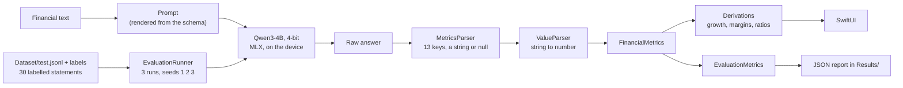

# FinancialEdgeAI

**Can a small language model extract structured financial data from text, running entirely on an iPhone?**
An iOS app, a labelled dataset and an evaluation harness that measure it.

## The question, and where this stands

> Can a small language model, specialised for a constrained financial information-extraction task, produce
> sufficiently reliable structured output to be useful for local inference on an iOS device?

The input is a sentence like *"Net income was $21 billion, down 4% from $21.9 billion in the previous year."*
The output is a set of fields copied from the text, read by code into numbers, and a few values that code
derives from them (growth, margins, free cash flow, ratios).

**This repository measures both halves: the unmodified model and a specialised one.** It is a personal project
without a deadline; it began as an academic challenge.

- Done: the app, a 300-statement labelled dataset, a measuring harness that runs on the device, the **baselines
  of the unmodified model** (v1.1.0 with 7 numeric fields; the current schema with 13 fields copied as printed,
  and the second call for the 5 balance sheet fields).
- Done: a **LoRA adapter** for the 13 core fields, trained on the Mac, loaded by the app and evaluated on the
  same frozen test split, with the same prompt, seeds and phone.
- **The hypothesis (specialisation helps) is confirmed on short synthetic statements, and, after a third adapter, on a small set of real text.** The
  first adapter raised the fully correct answers from 57 / 90 to 78 / 90 but made the model answer null for wording it had
  never seen (15 missed values). A second adapter, trained on data with several names for every metric, reaches
  85 / 90 on the same test with no missed value, and 77 / 90 against 34 / 90 on a second test of new wording, but on
  text from real annual reports it was no better than the unmodified model. A third adapter (`lora-v3`, Phase 2d), trained with synthetic
  sentences that look like the real ones that fooled it (segment figures, changes, costs, adjusted items), writes **no invented value** on 12 fresh real passages
  that were drawn after its training data was frozen (the unmodified model 12, `lora-v2` 13 and 21 for two seeds), keeps 85 / 90 on the old test, and the gain is far larger than the
  difference between two training runs. One failure is not fixed: a garbled key on one passage. See
  [the LoRA results](#results-the-lora-adapter), [lora-v2](#results-more-varied-training-data-lora-v2),
  [lora-v3](#results-real-style-distractors-in-the-training-data-lora-v3) and [Next steps](#next-steps).

## How the extraction is designed

The model **copies, code calculates.** This came out of the first baseline, where the model got units wrong
(33 fields) and calculated growths that were not in the text (9 fields).

- The model returns each value as a **string copied exactly as printed** (`"$726 million"`, `"$6.9bn"`,
  `"23.5%"`), or `null` when the text does not give it. It never converts, calculates or rounds.
- **`ValueParser`** reads the string: unit words, separators, `$` and `USD`, `%`, a minus sign, parentheses as
  negative. Amounts become billions of USD, growths a percent number, EPS dollars per share. A string it
  cannot read is flagged, never guessed.
- **`Derivations`** calculates what the text did not print: a missing growth (from the two amounts), operating
  and net margin, free cash flow, interest coverage, return on equity, debt to equity, current ratio, net
  debt. The printed value always wins, and the app marks every derived number.
- **`Dataset/schema.json`** is the only list of fields. The prompt is generated from it, and the parser, the
  evaluation and the screen read it, so a field is added in one place.

| Tier | Fields | When |
|---|---|---|
| Core (13) | `revenue`, `operatingIncome`, `netIncome`, `eps`, `interestExpense`, `operatingCashFlow`, `capex`, `previousYearRevenue`, `previousYearNetIncome`, `previousYearEps`, `revenueGrowth`, `netIncomeGrowth`, `epsGrowth` | every answer (this is what is built and measured) |
| Extended (5) | `totalDebt`, `shareholdersEquity`, `currentAssets`, `currentLiabilities`, `cash` | a second call with its own prompt, started by the button next to the text field; it adds return on equity, debt to equity, current ratio and net debt |

The decisions and their reasons are in [`Specs/`](Specs/phase-0-metrics.md).

## Results: the unmodified model, schema version 1

Model `Qwen3-4B` 4-bit (MLX), 30 frozen test statements, three runs, temperature 0.2, thinking off, on an
iPhone 16 (iOS 27.0.1, Debug build). Full analysis:
[`Results/baseline-analysis-schema1.md`](Results/baseline-analysis-schema1.md).

| Measure | Result |
|---|---|
| Answers the app can decode | **90 / 90 (100%)** |
| Needed a Markdown fence or a reasoning block | 0 / 90 |
| **All 13 fields correct** | **57 / 90 (63.3%)** |
| Fields correct | 1115 / 1170 (95.3%) |
| Unit errors, sign errors, wrong numbers, values missed | **0** |
| Strings copied exactly like the label | 318 / 381 (83.5%); 60 of the 63 others are read to the right value anyway |

**Every wrong field is the model writing something where the answer is null** (33 fields) or writing
something that is not a value (22 fields, refused by the parser). The 55 wrong fields fall in 11 of the 30
statements, in four groups:

| Cause | Wrong fields | Example |
|---|---|---|
| A growth filled in although the text prints none | 21 | `-$1.3 billion` as a net income growth: a difference of two amounts, not a percentage |
| A previous-year field filled in although the text prints none | 19 | the previous-year *operating profit* returned as the previous-year revenue |
| A current-period field from another period or a distractor | 12 | the free cash flow of a distractor returned as the operating cash flow |
| A correct number written in a form the parser refuses | 3 | `$10.3 billion dollars` |

### Results: the extended call (balance sheet)

The second call has its own prompt and its own baseline, on the same 30 statements
([`Results/baseline-analysis-extended.md`](Results/baseline-analysis-extended.md)):

| Measure | Result |
|---|---|
| Answers the app can decode | **90 / 90 (100%)** |
| **All 5 fields correct** | **78 / 90 (86.7%)** |
| Fields correct | 438 / 450 (97.3%); four fields are 100%, `cash` is 86.7% |
| Wrong fields | 12, all `cash`: the operating cash flow written as `cash` (9), a correct number the parser refuses (3) |
| Time per statement / peak memory | 4.0 s / 2.59 GiB (both calls together: about 14.5 s) |

### Results: the LoRA adapter

The adapter `lora-v1` (rank 8 on the last 16 layers, 7.3 M trained numbers, a 29.4 MB file) was trained on the 240
train statements and evaluated like the baseline: the same prompt, the same 30 test statements, three runs, the
same phone ([`Results/lora-v1-analysis.md`](Results/lora-v1-analysis.md), side by side:
[`Results/comparison-schema1-vs-lora-v1.md`](Results/comparison-schema1-vs-lora-v1.md)). The success criteria were
written before training ([`Specs/phase-2-lora.md`](Specs/phase-2-lora.md)).

| Measure | Baseline | With the adapter |
|---|---|---|
| Answers the app can decode | 90 / 90 | 90 / 90 |
| **All 13 fields correct** | 57 / 90 (63.3%) | **78 / 90 (86.7%)** |
| Fields correct | 1115 / 1170 (95.3%) | 1155 / 1170 (98.7%) |
| Fields hallucinated or refused by the parser | 55 | **0** |
| Fields **missed** (null where the text gives a value) | 0 | **15** |
| Time per statement / peak memory | 10.5 s / 2.72 GiB | 11.6 s / 2.86 GiB |

Criteria 1 (at least 68 / 90), 2 (at most 28 wrong fields) and 4 (at most 12 s, at most 3.0 GiB) are met;
**criterion 3 (no loss on what is right) is not**: all 15 missed values are in 4 statements whose wording
("net earnings", "cash generated from operations", "net sales a year earlier", "year-over-year growth") is in none
of the 270 training statements. The adapter learned that a null is the safe answer, and that is wrong for new
wording. On wording not in the training data (12 statements) the gain is smaller than on seen wording (58.3% to
75.0%, against 66.7% to 94.4%). The test split comes from the same generator as the train split: this is an
indication, not a measure, and no real report was tested.

### Results: more varied training data (lora-v2)

The first adapter missed values whenever the wording was not in its training data: the training statements had one phrase for
net income ("net income": 167 statements; "net earnings" and "net profit": none), and three fields were stated in only
10% to 12% of them. The second adapter (`lora-v2`) is trained on a new dataset (`Dataset/v2`): several names for every
metric, other structures, every field in at least a quarter of the statements, and a validation split whose wording is held out of
training. The method and hyperparameters are those of `lora-v1`; the stop of the training is decided by a program written
beforehand ([`Scripts/lora/stop_rule.py`](Scripts/lora/stop_rule.py)). The criteria were written before training
([`Specs/phase-2b-lora-wording.md`](Specs/phase-2b-lora-wording.md)); the analysis is
[`Results/lora-v2-analysis.md`](Results/lora-v2-analysis.md).

| Fully correct answers | Unmodified | `lora-v1` | `lora-v2` |
|---|---|---|---|
| The frozen test (30 statements x 3 runs) | 57 / 90 | 78 / 90 | **85 / 90** |
| Missed values on it | 0 | 15 | **0** |
| Wording not in training (pool B, 36 answers) | 21 / 36 | 27 / 36 | **34 / 36** |
| **Test 2** (30 new statements, new wording and structures) | 34 / 90 | 48 / 90 | **77 / 90** |
| Missed values on it | 9 | 56 | **6** |

All the accuracy criteria of the spec are met, on the frozen test and on test 2. **One practical criterion is missed, by
6 milliseconds**: the median time per statement is 12.006 s against a limit of 12 s (the first run of each evaluation is slower; the
other two are 10.7 s and 10.8 s). Memory is 2.86 GiB, thermal state "serious".

**Real text is another matter.** On passages from 17 real annual reports (not in the repository: only counts are published, labels
confirmed where in doubt) the adapters help on passages that are mostly distractors for `lora-v1` and not for `lora-v2`, and neither beats the
unmodified model on passages with headline statements. One passage makes both adapters write a garbled key (`previous6YearEps`,
`previous5000`): valid JSON that cannot be used, 3 answers in each set; the unmodified model never does this. The
synthetic result is real and replicated on two sets; the real-text result is a warning that the synthetic task is easier than the real
one. See [`Results/phase-2b-references.md`](Results/phase-2b-references.md).

### Safeguards in the app (Phase 2c)

Two failures of an adapted model are made visible and recoverable in the Extract tab, without touching the model, the prompt, the
dataset or the way an evaluation judges an answer ([`Results/phase-2c-safeguards.md`](Results/phase-2c-safeguards.md)):

- **A garbled key is repaired.** If an answer is valid JSON with the right number of keys and exactly one key is wrong at its position
  (`previous6YearEps`, `previous5000` where `previousYearEps` belongs), the app reads it as the schema's key and says so. Of the 14
  undecodable answers saved, 12 were of that kind: **all 12 become fully correct**, and no decodable answer changes (0 of 985). Evaluations stay
  strict.
- **A possible miss is shown.** Amounts with a unit word in the statement that no field used are listed as a hint. It is shown on 97% of the answers
  that miss an amount and on 31% of the fully correct ones (distractor amounts are "unused" too); it cannot see a missed percentage or per-share value
  (26% of the misses), and on real annual-report text it is shown on most answers, so it says little there.

### Results: real-style distractors in the training data (lora-v3)

`lora-v2` fails on real annual-report text because real paragraphs are full of figures it was never taught to ignore: a segment's revenue, a change in
amount, a cost line, an adjusted figure. The third adapter (`lora-v3`, Phase 2d) is trained on `Dataset/v3`: the data of `lora-v2` plus 240 synthetic statements of nine such
kinds, with fictional companies and generated numbers, never copied from a real report (a private check proves no run of six words is shared). Two seeds of `lora-v3` and a second seed of `lora-v2`
measure the noise of a training run. The full comparison, every criterion and the seed spread are in [`Results/lora-v3-analysis.md`](Results/lora-v3-analysis.md).

| Fully correct answers | Unmodified | `lora-v2` (2 seeds) | `lora-v3` (2 seeds) |
|---|---|---|---|
| Old test (90) | 57 | 85, 80 | **85, 85** |
| Test 2 (90, new wording) | 34 | 77, not run | **81**, not run |
| Test 3 (90, synthetic real-style) | 14 | 27, 16 | **66, 57** |
| `real1` (63, not blind) | 39 | 37, 30 | **57, 57** |
| `real2` (30, not blind) | 21 | 10, 11 | **24, 27** |
| `real3` (36, drawn blind; all-null is correct) | 24 | 19, 12 | **33, 36** |

- **Invented values on real text fall by far more than the noise:** `real1` 42 (unmodified), 33 and 39 (`lora-v2`), 3 and 9 (`lora-v3`); `real3` 12, 13 and 21, then 0 and 0.
- **The criteria:** seven of eight are met for the first `lora-v3` run. Not met: no undecodable answer on any set. One `real3` passage makes it write a key with a number inside
  (`previous4YearEps`) in all three runs, as `lora-v1` and `lora-v2` did on other sets; the second seed does not, and `lora-v2`'s second seed does it more. The app repairs this by position (Phase 2c).
- **Cost:** a few more missed values than `lora-v2` seed 1 on the synthetic sets (5 against 0 on the old test), mostly growths and previous-year values; within the noise by the rule of the spec, and fewer in the second seed.
- **Limits:** `real3` has 12 passages and no stated field (the 17 reports hold too few fresh paragraphs), so it measures not inventing a value, not extracting one; `real1` and `real2` were read while
  the training data was designed; two seeds are a thin measure of noise.

### What the iPhone costs

| | v1.1.0 (7 numbers) | Schema version 1 (13 strings) |
|---|---|---|
| Time per statement (median) | 6.0 s | 10.5 s |
| Time to first token (median) | 2.37 s | 3.68 s |
| Prompt / generated tokens (median) | 296 / 75 | 567 / 122 |
| Generation speed (median) | 21.5 tokens/s | 20.6 tokens/s |
| Peak MLX memory | 2.57 GiB | 2.72 GiB |
| Generation time in total (90 answers) | 9.5 min | 16.4 min |
| Thermal state | reached "serious" after 8 answers | reached "serious"; 12 answers started at it |

The run took 57 minutes on the wall clock, because the runner waits for the phone to cool. Plan an hour.

### Read these caveats before quoting a number

- **The two baselines are different experiments.** The prompt, the output format, the fields and the
  statements changed, so v1.1.0 (57 / 90 fully correct on 7 fields) and this one (57 / 90 on 13 fields) are
  not a before and after.
  [`Results/comparison-v1.1.0-vs-schema1.md`](Results/comparison-v1.1.0-vs-schema1.md) puts them side by side.
- **The three runs are nearly identical** (28 of 30 statements gave the same strings every time), so the
  sample is 30 statements, not 90 answers. One statement is 3.3 points.
- Debug build, one phone model, one model, one prompt, synthetic short statements, English and USD, no
  losses. The cash flow and interest fields are in only 3 to 5 test statements.
- "Valid JSON" means "the app's decoder can read it"; Foundation's parsers also accept a trailing comma.
- The first baseline (v1.1.0) and its analysis are kept: [`Results/baseline-analysis.md`](Results/baseline-analysis.md).
  Its dataset is archived in [`Dataset/archive/v1.1.0/`](Dataset/archive/v1.1.0).

## How it works



- **Model choice.** `qwen3_4b_4bit` was tested on the iPhone before use, against fixed criteria (not killed,
  at most 15 s per statement, at least 8 tokens/s, thermal state below "serious", download within 20
  minutes). It passed all of them, so the fallback `gemma3_1B_qat_4bit` was not needed
  ([`Results/model-gate.md`](Results/model-gate.md)).
- **Parser.** Tolerant about what surrounds the JSON (a reasoning block, a Markdown fence, a sentence),
  strict about the keys (exactly the core keys of the schema) and their types (a string or null). It records
  which tolerance it needed.
- **Evaluation.** Every field is judged on the number read from the model's string against the true number:
  *correct*, *hallucinated* (null expected, a value given), *missed*, a *sign error*, a *unit error* (x1000),
  *wrong*, *unreadable* (a string that is no value), or *unparsed* (an unreadable answer). Whether the string
  was copied exactly is recorded as a diagnostic. Every statement gets a fresh chat session, a fixed seed and
  a token limit (384). The phone is not allowed to run hot: the runner waits (at most two minutes) while the
  thermal state is "serious".
- **The oracle tests.** The dataset carries the true value of every printed string, written by the
  generator without the parser. For every statement of every split, `ValueParser(text)` must equal that
  value, and the dataset's own answers, run through the parser and the metrics, must score 100%. If they do
  not, the evaluation itself is wrong.

### The dataset

300 labelled statements ([`Dataset/`](Dataset/README.md)): 240 train, 30 validation, 30 test. 276 are
generated from templates (labels correct by construction), 24 are hand-written. The test split is frozen.
Twelve of its 30 statements use wording that is not in train or validation, so it also tests unseen phrasing.
The scenarios include prior-year amounts, distractor numbers (margins, guidance, free cash flow, share
price), statements in millions, EPS, cash flow, balance sheet items, and statements without any requested
field. The prompt is generated from `schema.json`, bundled in the app, and `Scripts/validate_dataset.py`
fails if a bundled copy differs, if a label is not in its statement, or if a statement contains a number
of the prompt's own examples.

## Repository

```
FinancialEdgeAI/                 Xcode app target (Swift, SwiftUI, MLX)
├── App/        FinancialEdgeAIApp.swift       entry point, two tabs
├── Models/     Schema, FinancialMetrics, GenerationResult, ExtractionExample, EvaluationRecord
├── Services/   LLMService                     MLX model loading and inference
│               ExtractionPrompt, PromptTemplate
│               MetricsParser, ValueParser, Derivations
│               DatasetLoader, EvaluationMetrics, EvaluationRunner
├── ViewModel/  ChatViewModel, EvaluationViewModel, MetricsPresenter
├── Views/      ContentView (Extract), EvaluationView (Evaluate, work in progress)
└── Resources/  schema, prompt files and test split (bundled copies, checked for drift)
FinancialEdgeAITests/            Swift Testing, 326 tests
Dataset/                         300 labelled statements, schema.json, the prompt, labels, archive/v1.1.0
Scripts/                         generate and validate the dataset, render the prompt, summarise and compare reports
Scripts/lora/                    LoRA training: data check, config, run record (needs mlx-lm; weights never committed)
Results/                         model gate, the baselines and the LoRA run (reports, tables, analysis), comparisons
Specs/                           the written specs of each phase (metrics, schema, extended call, LoRA, safeguards, real-style distractors)
```

## Run it

Requirements: Xcode 27, a **physical iPhone** (MLX cannot run on the simulator: the app starts there and
says so, instead of crashing), and a network connection on the first launch only.

1. Open `FinancialEdgeAI.xcodeproj`, select the iPhone, run.
2. The first launch downloads the model (about 2.3 GB). After that the app works offline.
3. **Extract** tab: paste a statement, or tap *Sample*, then *Send*. It shows the 13 core fields (null is
   shown, a string that cannot be read is shown with a warning), what was printed under each number, the
   values derived by code, what had to be skipped to read the answer, and what the answer cost. The
   *balance sheet* button next to the text field makes the second call on the last statement and adds the five
   balance sheet fields and the ratios that need them.
4. **Evaluate** tab (marked *work in progress*: a development tool that measures the model, not part of the
   final app): a picker chooses the core call or the balance sheet call, and *Start evaluation* runs the 30
   test statements three times (about an hour on the phone for the core call, 16 minutes of generation, the
   rest is cooling; about 17 minutes for the balance sheet call). The screen stays on, because iOS does not allow GPU work in
   the background and MLX stops the app if it is attempted. *Share* exports the full JSON report.
5. Without touching the phone (it must be unlocked when the app starts): launch the installed app from the
   command line with `xcrun devicectl device process launch --device <id> --console
   GianlucaPascarella.Dev.FinancialEdgeAI -- -autoRunEvaluation YES` (add `-evaluationTier extended` for the
   balance sheet call), then copy the report from the app's
   `Documents` folder with `xcrun devicectl device copy from --domain-type appDataContainer ...`.
6. With an adapter: copy the folder (`adapter_config.json`, `adapters.safetensors`) to the app's
   `Documents/Adapters/<name>` with `xcrun devicectl device copy to`, and add `-adapterName <name>` to the launch
   arguments. The screen and the report say which adapter is on; if it cannot be loaded the load fails (the app never
   runs the base model while saying "adapter"). Training: [`Scripts/lora/README.md`](Scripts/lora/README.md).
7. `python3 Scripts/summarize_results.py <report.json>` prints the tables and every failing statement.
   `python3 Scripts/compare_baselines.py <old.json> <new.json>` puts two reports side by side.

```
python3 Scripts/validate_dataset.py     # schema, prompt, labels, leakage, bundled copies
python3 Scripts/prompt_from_schema.py   # prints the prompt rendered from the schema
```

Unit tests: run the `FinancialEdgeAITests` scheme on a simulator (the app scheme has no tests). The test
bundle compiles the pure sources (schema, parsers, derivations, metrics, loader, presenter) directly and does
not host the app, because a hosted test target would also have to resolve every MLX package module and does
not build.

### Reproducing a result

A report records the model, the device, the temperature, the token limit, the seeds, and SHA-256 hashes of
the prompt, of the test split with its labels, and of the schema. The schema 1 baseline: Qwen3-4B 4-bit
(`mlx-community/Qwen3-4B-4bit`), `mlx-swift-lm` 3.32.3, `mlx-swift` 0.32.3, Xcode 27.1, temperature 0.2,
`maxTokens` 384, seeds 1, 2, 3.

## Next steps

The synthetic task is solved well enough to be measured against real text, which it does not yet cover. What to do next, each a
new experiment with its own comparison:

1. **More real passages, with stated fields.** Phase 2d is read on 12 fresh passages with no stated field; a larger blind set from other reports (the 17 reports are used up) would measure extraction on real text too.
2. **A garbled key** is now repaired in the app (Phase 2c) instead of asked again; the cause (the adapter writing it) remains, and constrained
   decoding would remove it if it becomes available.
3. **A third seed**, and the second seeds on test 2 (not run in Phase 2d): two seeds give a thin spread, and the cost of `lora-v3` (a few more missed growths and previous-year values) is within it, but is the direction to watch.
4. **A sharper hint.** The possible-miss hint is shown (Phase 2c) but is noisy on distractor amounts and blind to percentages and per-share
   values; a better hint is a new experiment.
5. **An adapter for the balance sheet call** (the operating cash flow is not the cash balance).
6. **Three small things to look at,** each a new experiment with its own baseline: the parser could accept
   `$10.3 billion dollars` (seen in both calls), a growth returned by the model could be checked against the two
   amounts, and the prompt could say in words that a previous-year field stays null when only the current
   value is given.

**Practical points.** The adapter was trained with the Python tool `mlx_lm.lora`, which reads the chat `messages`
format of the dataset directly (the Swift trainer `LoRATrain` reads `{"text": ...}` lines). An adapter only works
with the base model it was trained on, and it runs unfused in the app (about 10% slower per answer). Weights and
adapters are not committed (`.gitignore` excludes them): the config, the data and the run record
([`Scripts/lora/runs/lora-v1.md`](Scripts/lora/runs/lora-v1.md), [`lora-v2.md`](Scripts/lora/runs/lora-v2.md), [`lora-v3.md`](Scripts/lora/runs/lora-v3.md)) are.

**Other next steps.** A Release build for the speed numbers, real reports instead of synthetic statements,
a larger test split, the overview and business sections of a report, PDF input, a comparison with a smaller
model (`gemma3_1B_qat_4bit`), and energy measurements.

## Documentation

The work is documented step by step in Notion: *Guiding step* (what was done, why, what was observed, in
order), *FinancialEdge Workflow* (the project brief, the roadmap and the decisions) and *AI work summary*
(what the AI assistant did, decided and measured, in detail). The written specs of the phases are in
[`Specs/`](Specs/).

## Acknowledgements

[MLX](https://github.com/ml-explore/mlx) and [`mlx-swift-lm`](https://github.com/ml-explore/mlx-swift-lm)
for on-device inference, the `mlx-community` conversion of Qwen3-4B, and the Hugging Face Hub client for the
download.
